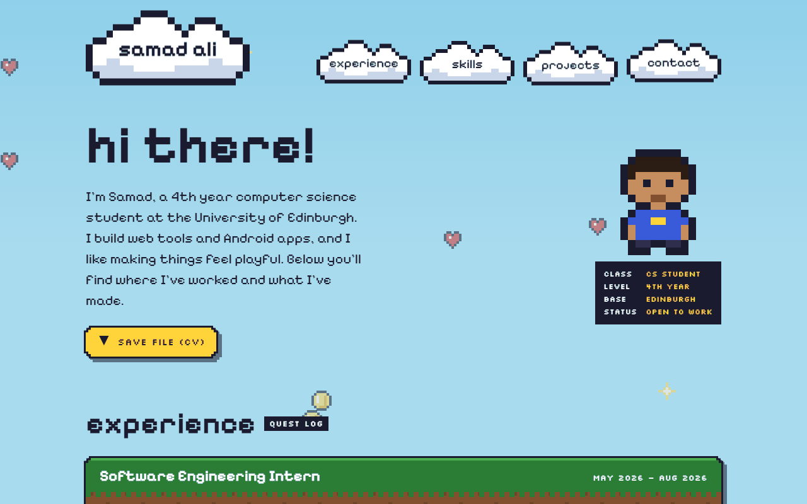
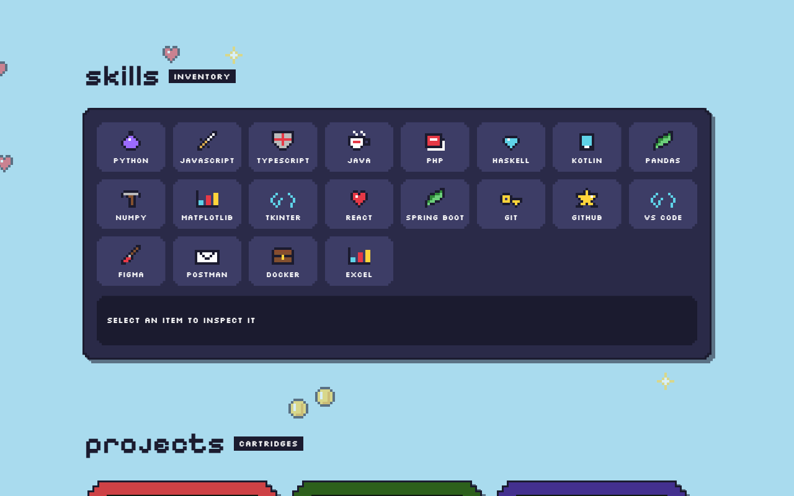
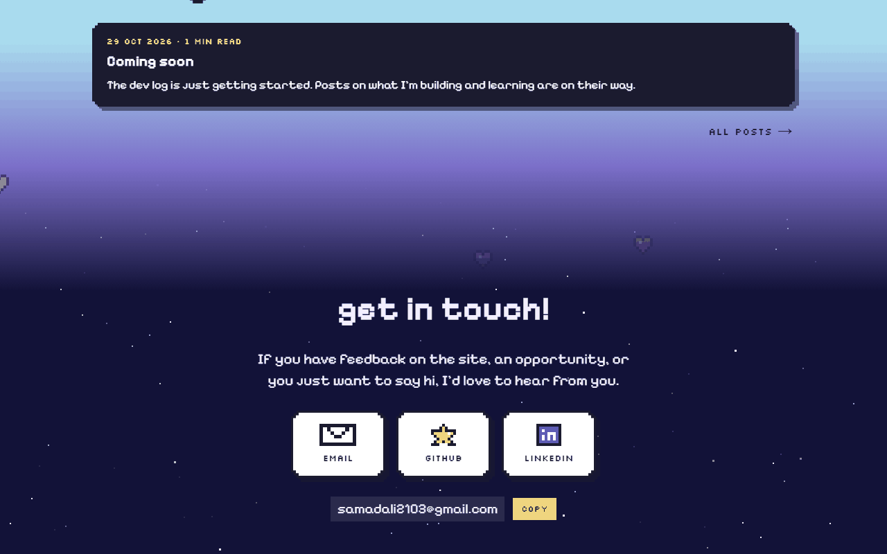
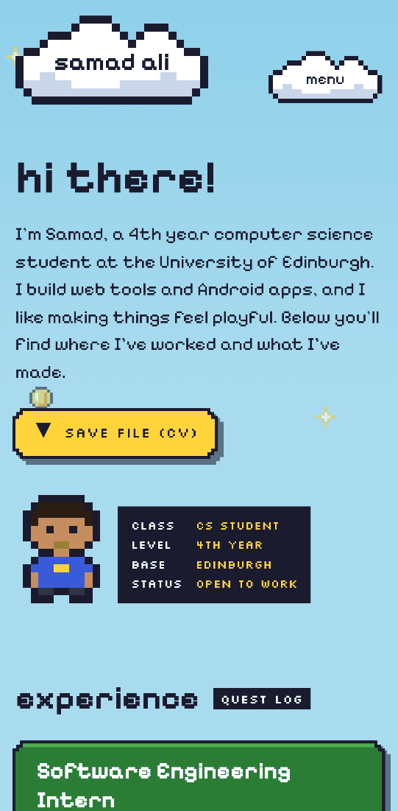

# Portfolio Site

[](https://github.com/samad-a/portfolio-site/actions/workflows/ci.yml)

**Live at [samadali.dev](https://samadali.dev)**

My personal portfolio: a retro pixel-art site where the sky turns from day to
night as you scroll. It brings together my experience, skills, projects with
case studies, and a dev log, and doubles as a showcase of how I build and ship
a web app: typed content, automated tests, accessibility checks and a preview
deploy for every change.



| Skills inventory and projects                                                                                  | Night sky and contact                                                                                            |
| -------------------------------------------------------------------------------------------------------------- | ---------------------------------------------------------------------------------------------------------------- |
|  |  |



## What's on the site

- **Experience** as grass-and-dirt blocks, from data in `content/experience.json`.
- **Skills** as an inventory: point at, tab to or tap an item to see which projects use it.
- **Projects** as handheld consoles in a row you can scroll or step through, each coloured from the project's branding, with an MDX case study page.
- **Dev log** in MDX, with highlighted code, reading times and an RSS feed.
- **Contact** links and a form that emails me through Resend.
- An animated canvas sky, a GAME OVER 404 page and a Konami code easter egg.

<br clear="right" />

## Stack

| Layer     | Choice                                                        |
| --------- | ------------------------------------------------------------- |
| Framework | Next.js 16 (App Router), React 19, TypeScript (strict)        |
| Styling   | Tailwind CSS 4 with a custom pixel theme                      |
| Content   | JSON and MDX, validated with Zod                              |
| Email     | Server Action + Resend                                        |
| Testing   | Vitest, React Testing Library, Playwright, axe, Lighthouse CI |
| Tooling   | ESLint, Prettier, Husky, lint-staged, commitlint              |
| Hosting   | Vercel, with Analytics and Speed Insights                     |

## How it's built

```
app/          Routes: homepage, /projects/[id], /blog, /blog/[slug], RSS,
              sitemap, robots, icons and social preview images
components/   UI by section (home, experience, skills, projects, blog, contact),
              the sky canvas, and shared pixel UI (PixelButton, PixelPanel)
content/      experience.json, projects.json, skills.json, project case studies
              and blog posts in MDX
lib/          Content schemas and loaders, blog loader and RSS, sprites, sky
              maths, contact form action and schema, metadata helpers
e2e/          Playwright tests, including axe accessibility checks
```

- **Sprites are code.** Every sprite is a grid of letters, one per palette colour (`lib/sprites`). A template-literal type turns an unknown colour into a compile error, a test checks every row is the same width, and each sprite renders as an SVG with neighbouring same-colour pixels merged into one rectangle.
- **Content can't break the site.** Experience, projects, skills and post frontmatter are checked with Zod in CI. A typo, a missing field, a date that doesn't exist or a console colour too light for white text fails with a message naming the file and the problem.
- **The sky is one canvas.** A fixed canvas behind the page draws a gradient tied to positions on the page (day, dusk at the contact section, night), drifting sprites and twinkling stars. It draws at CSS resolution with `image-rendering: pixelated`, pauses when the tab is hidden, and becomes a still picture for people who prefer reduced motion.
- **Pixel shapes stay accessible.** Stepped corners are a `clip-path` utility. Clipping hides borders and focus outlines, so outlines and shadows are drop-shadow filters on a wrapper, and focus rings are drawn inside the shape.
- **Everything is static.** Every page, preview image and feed is generated at build time. The only server code is the contact form's Server Action.

## Quality checks

Every pull request runs:

- ESLint, TypeScript, Prettier and Vitest unit and component tests, then a production build.
- **Lighthouse CI** on the homepage, a case study, the blog and a post. Every category must score at least 90.
- **Playwright** against the Vercel preview of that commit, including axe checks for WCAG 2.2 AA on every page type, the open mobile menu and the contact form's errors.

`main` only changes through pull requests that pass these checks. Commits follow [Conventional Commits](https://www.conventionalcommits.org/), and Git hooks lint, format and type-check staged files before each commit.

## Local setup

You need Node.js 20.9 or later.

```bash
git clone git@github.com:samad-a/portfolio-site.git
cd portfolio-site
npm install
npm run dev
```

Then open [http://localhost:3000](http://localhost:3000).

`npm install` also sets up the Git hooks.

### Environment variables

The contact form sends email with [Resend](https://resend.com). To try it
locally, copy `.env.example` to `.env.local` and add a Resend API key. On
Vercel, set the same variables under Settings > Environment Variables. Without
a key, the form shows a friendly error and the rest of the site works.

### Writing a blog post

Add `content/blog/my-post.mdx`, starting with:

```yaml
---
title: My post
summary: One or two sentences for the index and the feed.
published: 2026-10-30
draft: true # optional, hides the post until it's ready
---
```

## Scripts

| Command                | What it does                              |
| ---------------------- | ----------------------------------------- |
| `npm run dev`          | Start the dev server                      |
| `npm run build`        | Build for production                      |
| `npm run start`        | Serve the production build                |
| `npm run lint`         | Lint with ESLint                          |
| `npm run typecheck`    | Type-check with TypeScript                |
| `npm run format`       | Format all files with Prettier            |
| `npm run format:check` | Check formatting without changing files   |
| `npm test`             | Run unit and component tests with Vitest  |
| `npm run test:e2e`     | Build, serve and run the Playwright tests |
